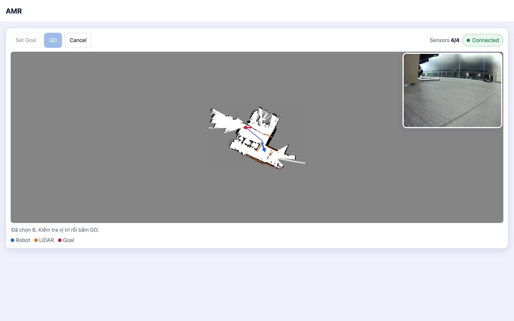

# AMR

Mobile robot platform with ROS 2, navigation, and a web UI for the real robot.



## Topology

```text
Browser / tablet
        │ HTTP · WebSocket · MJPEG
        ▼
ROS 2 stack on Raspberry Pi 5 (Docker)
        ├── SLAM · navigation backend · EKF · web_bridge
        ├── rosbridge · camera_mjpeg · cmd_vel_arbiter
        └── Micro XRCE-DDS Agent
        │
        │ USB serial / Micro XRCE-DDS
        ▼
ESP32 micro-ROS client
        └── Motor · Encoder · IMU · Servo · Buzzer

Hardware:
Raspberry Pi 5 ── LiDAR USB · Camera USB
ESP32 ─────────── Robot hardware control
```

Main data flows:

```text
Browser / tablet
├── Goal:   /web/goal_pose ───────────────> web_bridge ─> navigation ─> /cmd_vel_nav ─┐
├── Manual: /web/cmd_vel_manual ────────────────────────────────────────────────┼─> cmd_vel_arbiter ─> /cmd_vel ─> Agent ─> ESP32 ─> Motor
├── Mode:   /web/control_mode ──────────────────────────────────────────────────┘
├── Map:    /web/map <──────────────────── web_bridge <─ /map <─ slam_toolbox <─ /scan (LiDAR)
├── Scan:   /web/scan_points <──────────── web_bridge <─ /scan (LiDAR)
├── Pose:   /robot_pose <───────────────── web_bridge <─ /odom + TF <─ EKF <─ /imu + /odom_raw (ESP32)
└── Camera: MJPEG :8081 <───────────────── camera_mjpeg <─ /dev/video0 (USB camera)
```

`web.launch.py` starts the stack in the ROS container, but does not start the
LiDAR driver or the micro-ROS Agent. See [`docs/web_topics.md`](docs/web_topics.md)
for the web topic details.

## Run the robot

```bash
./build.sh
./bootstrap.sh
./shell.sh
ros2 launch bringup web.launch.py
```

### Web UI

```bash
./serve_web.sh
```

Open [http://localhost:8080](http://localhost:8080).

### Stop

Press `Ctrl+C`, then run:

```bash
docker rm -f yahboom-ros-main yahboom-micro-ros-agent
```
